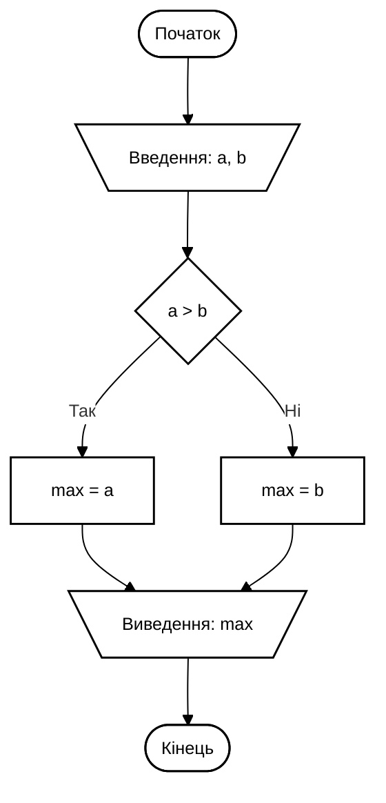
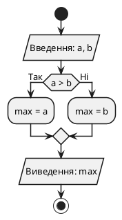

# Скіл: Академічні блок-схеми за ГОСТ 19.701-90 та UML 2.5

Цей скіл призначений для автоматичної побудови блок-схем алгоритмів та UML-діаграм для програмного забезпечення. Всі діаграми мають однаковий, мінімалістичний та академічно строгий вигляд, що відповідає вимогам до курсових робіт, дипломних проєктів, звітів з лабораторних робіт та стандартів **ГОСТ 19.701-90 / ДСТУ ISO 5807:1985** і **UML 2.5**.

---

## ⛔ 4 Залізні правила оформлення (ОБОВ'ЯЗКОВО ДЛЯ ВСІХ АГЕНТІВ)

Будь-який агент, що генерує діаграму за цим скілом, **ПОВИНЕН** суворо дотримуватися наступних обмежень:

1. **Жодних заголовків та рамок на зображенні:**
   - На самому малюнку (SVG/рендері) **ЗАБОРОНЕНО** додавати будь-які назви схем (наприклад, "Блок-схема алгоритму...", "Рис. 1.2"), рамки аркуша, підписи версій чи легенди.
   - Схема починається безпосередньо з першого функціонального вузла (`Початок` або `●`) зверху і закінчується вузлом завершення (`Кінець` або `⦿`) знизу.
   - Усі текстові назви та номери рисунків розміщуються **лише в тексті документа**, що оточує малюнок.

2. **Прозорий фон зображення та біла заливка блоків:**
   - Кореневий SVG завжди має `background: transparent;`.
   - Самі фігури (прямокутники, ромби, паралелограми тощо) обов'язково мають `fill: #ffffff;` (біла заливка). Це гарантує, що лінії зв'язку, які проходять під блоками, не перекреслюють текст.
   - Лінії та контури: виключно чорні `#000000`, товщина контуру суворо `1.5px` (або `stroke-width="1.5"`).

3. **Суто українська мова:**
   - Усі службові та описові тексти у вузлах мають бути українською мовою:
     - `Початок`, `Кінець`, `Вхід`, `Вихід`
     - `Введення: a, b`, `Виведення: res, max`
     - `Так`, `Ні` (біля ліній умов)
     - `сума = 0`, `i = 0, n - 1, 1`
     - Для підпрограм: `Сортування(arr, n)` або назви функцій згідно з кодом.

4. **Інженерна геометрія (ГОСТ 19.701-90):**
   - Усі злами ліній зв'язку — **строго під прямим кутом 90°** (ніяких діагоналей чи кривих ліній).
   - Лінії входять у вершину блоку суворо по центру зверху, виходять по центру знизу або з центру бічних граней.
   - Наконечники стрілок — гострі трикутні (розмір 6-8px, чорні `#000000`). Стрілки обов'язкові на вході в блоки та на лініях зворотного зв'язку (цикли).

---

## 📐 Довідник геометричних блоків ГОСТ 19.701-90 (ISO 5807)

| Елемент стандарту | Призначення | Форма в SVG | Приклад коду в SVG |
| :--- | :--- | :--- | :--- |
| **Термінатор** | Початок або кінець алгоритму | Прямокутник зі скругленими лівим і правим краями ($r = h/2$) | `<rect x="150" y="20" width="150" height="38" rx="19" ry="19" class="block" />` |
| **Дані (Введення / Виведення)** | Введення даних з клавіатури/файлу, виведення на екран | Паралелограм зі зсувом бічних граней 20px (кут ~75°-80°) | `<polygon points="140,86 330,86 310,126 120,126" class="block" />` |
| **Процес (Дія)** | Арифметичні операції, присвоєння змінних, логіка | Прямокутник (співвідношення сторін $1.5 : 1$) | `<rect x="145" y="154" width="160" height="40" class="block" />` |
| **Рішення (Умова)** | Логічна умова, розгалуження потоку | Ромб (Diamond) з виходами "Так" і "Ні" | `<polygon points="225,230 315,268 225,306 135,268" class="block" />` |
| **Зумовлений процес** | Виклик підпрограми, методу чи зовнішньої функції | Прямокутник з двома внутрішніми вертикальними рисками з боків | `<rect x="105" y="170" width="240" height="46" class="block" /><line x1="122" y1="170" x2="122" y2="216" class="line" /><line x1="328" y1="170" x2="328" y2="216" class="line" />` |
| **Підготовка** | Заголовок циклу з лічильником (`for i = 0 to n-1`) | Витягнутий шестикутник зі зрізаними бічними трикутниками | `<polygon points="160,222 290,222 315,244 290,266 160,266 135,244" class="block" />` |
| **З'єднувач** | Перехід лінії зв'язку без перетину ліній | Коло діаметром 30–40px з номером всередині | `<circle cx="225" cy="354" r="18" class="block" />` |

---

## ⚡ Довідник елементів UML 2.5 (Академічний мінімалізм)

Якщо завдання вимагає нотації UML:

1. **UML Activity Diagram (Діаграма діяльності):**
   - **Початок (Initial Node):** заповнений чорний круг діаметром 20-24px (`<circle r="11" fill="#000000" />`).
   - **Дії (Action):** прямокутники зі скругленими кутами радіусом 8-10px (`rx="8" ry="8"`).
   - **Розгалуження (Decision):** невеликий ромб з виходами у квадратних дужках: `[успішно]`, `[помилка]`.
   - **Паралелізм (Fork / Join):** суцільні чорні смуги товщиною 5-6px (`<rect height="5" fill="#000000" />`).
   - **Кінець (Activity Final Node):** бичаче око — коло з чорною крапкою всередині (`<circle r="14" fill="#ffffff" stroke="#000000" stroke-width="1.5" /><circle r="8" fill="#000000" />`).

2. **UML Sequence Diagram (Діаграма послідовності):**
   - Прямокутники учасників вгорі: `Користувач`, `Інтерфейс`, `Сервер`, `БазаДаних`.
   - Вертикальні пунктирні лінії життя (`stroke-dasharray="4,4"`).
   - Вузькі білі смуги активації (Activation bars) шириною 10px.
   - Синхронні виклики: суцільна лінія з трикутною стрілкою (`->>`).
   - Відповіді (Return): пунктирна лінія з відкритою стрілкою (`-->>`).
   - Блок альтернатив: рамка з позначкою `alt` та пунктирним роздільником гілок.

3. **UML Class Diagram (Діаграма класів):**
   - Класи з трьома секціями: назва, атрибути, методи.
   - Модифікатори доступу: `+` (public), `-` (private), `#` (protected).
   - Наслідування: суцільна лінія з незафарбованим трикутним наконечником (`──▷`).
   - Реалізація інтерфейсу: пунктирна лінія з незафарбованим трикутником (`┈┈▷`).
   - Агрегація / Композиція: лінія з ромбом (порожнім або чорним).

---

## 🛠️ Готові шаблони для генерації

### Варіант 1: Чистий SVG-шаблон (ГОСТ 19.701-90)

Коли агент створює `.svg` файл, він використовує такий стандартизований скелет:

```xml
<svg xmlns="http://www.w3.org/2000/svg" viewBox="0 0 450 600" width="100%" height="100%" style="background: transparent; font-family: 'Segoe UI', Arial, sans-serif;">
  <defs>
    <marker id="gost-arrow" viewBox="0 0 10 10" refX="10" refY="5" markerWidth="6" markerHeight="6" orient="auto-start-reverse">
      <path d="M 0 1.5 L 10 5 L 0 8.5 z" fill="#000000" />
    </marker>
    <style>
      .line { stroke: #000000; stroke-width: 1.5; fill: none; stroke-linecap: square; stroke-linejoin: miter; }
      .block { stroke: #000000; stroke-width: 1.5; fill: #ffffff; }
      .txt { font-size: 13px; font-weight: 500; fill: #000000; text-anchor: middle; dominant-baseline: central; }
      .lbl { font-size: 12px; font-weight: 600; fill: #000000; }
    </style>
  </defs>

  <!-- 1. Початок -->
  <rect x="150" y="20" width="150" height="38" rx="19" ry="19" class="block" />
  <text x="225" y="39" class="txt">Початок</text>

  <!-- Лінія -->
  <line x1="225" y1="58" x2="225" y2="88" class="line" marker-end="url(#gost-arrow)" />

  <!-- 2. Введення даних -->
  <polygon points="145,88 325,88 305,128 125,128" class="block" />
  <text x="225" y="108" class="txt">Введення: a, b</text>

  <!-- Лінія -->
  <line x1="225" y1="128" x2="225" y2="158" class="line" marker-end="url(#gost-arrow)" />

  <!-- 3. Умова (Ромб) -->
  <polygon points="225,158 315,198 225,238 135,198" class="block" />
  <text x="225" y="198" class="txt">a &gt; b</text>

  <!-- Гілка Так (праворуч) -->
  <line x1="315" y1="198" x2="360" y2="198" class="line" />
  <line x1="360" y1="198" x2="360" y2="260" class="line" marker-end="url(#gost-arrow)" />
  <text x="325" y="190" class="lbl">Так</text>
  <rect x="305" y="260" width="110" height="40" class="block" />
  <text x="360" y="280" class="txt">max = a</text>

  <!-- Гілка Ні (вниз) -->
  <line x1="225" y1="238" x2="225" y2="260" class="line" marker-end="url(#gost-arrow)" />
  <text x="233" y="252" class="lbl">Ні</text>
  <rect x="170" y="260" width="110" height="40" class="block" />
  <text x="225" y="280" class="txt">max = b</text>

  <!-- Зведення ліній під 90 градусів -->
  <line x1="360" y1="300" x2="360" y2="330" class="line" />
  <line x1="360" y1="330" x2="225" y2="330" class="line" />
  <line x1="225" y1="300" x2="225" y2="360" class="line" marker-end="url(#gost-arrow)" />

  <!-- 4. Виведення результату -->
  <polygon points="145,360 325,360 305,400 125,400" class="block" />
  <text x="225" y="380" class="txt">Виведення: max</text>

  <!-- Лінія -->
  <line x1="225" y1="400" x2="225" y2="430" class="line" marker-end="url(#gost-arrow)" />

  <!-- 5. Кінець -->
  <rect x="150" y="430" width="150" height="38" rx="19" ry="19" class="block" />
  <text x="225" y="449" class="txt">Кінець</text>
</svg>
```

---

### Варіант 2: Mermaid для Markdown (Академічний ч/б)

Якщо діаграма генерується для звіту, документації або README у Markdown, агент вставляє блок Mermaid з обов'язковою ініціалізацією чорно-білої теми:



---

### Варіант 3: PlantUML (Академічний ч/б)



---

## 📋 Чек-лист перевірки для агента перед видачею результату:

Перед тим як надати результат користувачу або зберегти файл, агент **ЗОБОВ'ЯЗАНИЙ** перевірити себе за цими пунктами:

- [ ] **Немає жодного заголовка всередині малюнка:** чи відсутні написи типу "Блок-схема", номери рисунків або декоративні плашки?
- [ ] **Прозорий фон:** чи встановлено `style="background: transparent;"` (або відсутній колір тла SVG)?
- [ ] **Біла заливка всередині фігур:** чи мають блоки `fill="#ffffff"`, щоб лінії під ними не просвічували?
- [ ] **Суто український текст:** чи перекладено всі терміни (`Початок`, `Кінець`, `Введення`, `Виведення`, `Так`, `Ні`)?
- [ ] **Кути 90 градусів:** чи всі переходи та лінії зведення мають строгі прямі кути без скосів?
- [ ] **Стрілки:** чи стоять наконечники на входах у блоки та на зворотному зв'язку циклів?
- [ ] **Форма фігур:** чи використовуються паралелограми для вводу/виводу, овали для старту/кінця, ромби для умов?

---

## 📍 Еталонні зразки в репозиторії:
Всі еталонні файли версії V1 зберігаються у директорії:
- [diagram_examples_v1](file:///C:/Users/muaro/Documents/GitHub/Learning-assistent/diagram_examples_v1)
- Інтерактивна галерея для перевірки: [index.html](file:///C:/Users/muaro/Documents/GitHub/Learning-assistent/diagram_examples_v1/index.html)
