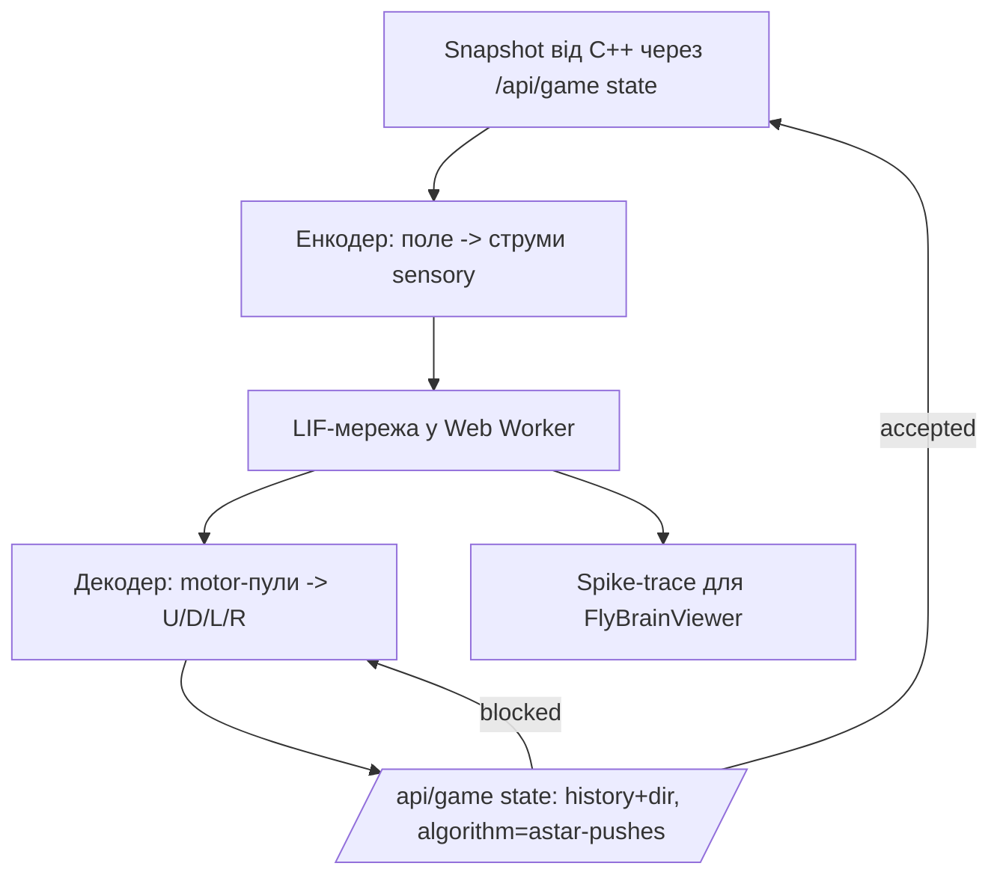

# Прототип 8 · FlyBrain — скопійований мозок мухи як web-only біо-агент

## 1. Статус і призначення

Це пропозиція **web-only** демонстраційного солвера для Sokoban: спрощена симуляція мозку дрозофіли (LIF-мережа за мотивами FlyWire-коннектому) в закритому контурі намагається пройти рівень.

Головна ідея як у DishBrain (культура нейронів грає в Pong): стан поля кодується в стимуляцію сенсорних нейронів, спайки декодуються в `U/D/L/R`, хід перевіряється C++ ядром, нове поле знову подається в мозок.

Призначення — навчальне: показати різницю між точним пошуком (BFS/A*) і біо-наївним агентом, дати живу візуалізацію спайків + аналітику. **Не заявляти як оптимальний solver.**

Тільки для web (`web/`). CLI (`src/`, `sokoban_cli.exe`) і C++ ядро **не чіпати**.

## 2. Що це НЕ є (чесність перед користувачем)

- Це НЕ повний коннектом 139 255 нейронів / 50М синапсів. Це синтетична мережа 2 004 LIF-нейронів: 64 sensory, 1 600 KC, 16 MBON, 16 CX, 64 FB, 84 PB та 160 motor. Компас використовує додаткові 16 нормованих rate-секторів, пов’язаних із CX. Геометрія, нейромодуляція й декодер поведінки спрощені; це не перевірена біологічна реконструкція.
- Це НЕ жива муха і НЕ MEA-залізо. Жодних електродів, тільки TypeScript-симуляція.
- НЕ гарантує рішення. Муха еволюційно вміє навігацію/фототаксис, а не штовхання ящиків з дедлоками. На складних рівнях вона зациклиться — це очікувано і показується в UI як `LimitReached`-подібний результат.
- Підпис в UI обов'язковий: `Біо-агент · не гарантує рішення · ліміт N кроків`.

## 3. Науковий базис (для опису в UI/курсовій, 4 факти)

1. FlyWire, `Nature` 02.10.2024: повний коннектом дорослої Drosophila — 139 255 нейронів, ~50М синапсів. Дані: `flywire.ai`, `codex.flywire.ai`.
2. Shiu et al., `Nature` 2024: LIF-модель всього мозку мухи запускається на ноутбуці і >90% передбачає сенсомоторні реакції.
3. Kagan et al., `Neuron` 2022 (DishBrain): ~800к нейронів на MEA навчились Pong за 5 хв у закритому контурі. Звідси береться архітектура `сенсорика → мозок → моторика → середовище → сенсорика`.
4. Eon Systems, 03.2026: емуляція ~125к нейронів + тіло `NeuroMechFly v2 + MuJoCo` рухається без коду ходьби. Доводить, що коннектом → поведінка без RL-нагороди можливий.

## 4. Архітектура



Ключове правило проєкту (див. `docs/AGENTS.md`, `docs/19_WEB_BRIDGE_AND_API.md`): **C++ ядро — єдиний арбітр правил.** Мозок лише пропонує напрямок, `accepted/blocked` вирішує сервер. Локальний `replayState` (як у `EvolutionViewer.tsx:15`) дозволений тільки для малювання сліду, не для валідації фінального маршруту.

Виконання: симуляція в Web Worker (не блокувати `BoardView`), візуалізація — Canvas 2D (без three.js, як вимагає прототип 2), React тільки для контролів.

## 5. Дані з наявної програми (перевикористати)

- `Snapshot { board, state, moves, pushes, won, accepted }` — з `web/src/lib/types.ts:63-81`. Поле сканується парсером один раз, прототип бере позиції з `state`.
- `request<Snapshot>(history, "state", dir, "astar-pushes")` з `Game.tsx:246` — єдиний спосіб зробити хід. Режим `"solve"` для flybrain **заборонений** (C++ його не знає).
- `BoardView`, `BoardMarker`, `BoardCellHint` — для показу поля і сліду маршруту.
- `EvolutionViewer.tsx` — взяти як шаблон плеєра: режими individual/generation, скрабер, play/pause, fitness-чарт. Не копіювати логіку гравітації/ДНК, тільки каркас.
- `SearchResult` + `Decision` + `sessionStorage` — для картки результату. Повні спайк-трейни в `sessionStorage` **не писати** (ліміт), тільки саммарі (див. §7).

## 6. Файли: створити / змінити

| Дія | Файл | Зміст |
|---|---|---|
| Створити | `web/src/lib/flybrain.ts` | LIF-мережа + енкодер/декодер, чисті функції без React. Експорт `createFlyBrain(seed)`, `stepBrain(brain, currents): { spikes }`, `encodeState(snapshot, history): Float32Array`, `decodeAction(motorSpikes): Dir` |
| Створити | `web/src/workers/flybrain.worker.ts` | Цикл closed-loop: отримує `snapshot+base`, ганяє кроки, постить `trace`-події назад. Весь `setTimeout`/крок тут, не в UI |
| Створити | `web/src/components/FlyBrainViewer.tsx` | Canvas-растр спайків + міні-поле + аналітика. Props як у `EvolutionViewer`: `{ result, loadSnapshot }` |
| Змінити | `web/src/lib/types.ts` | `Algorithm = LocalAlgorithm \| "gemini" \| "flybrain"`, **НЕ** додавати в `LOCAL_ALGORITHMS` (щоб `/api/game` відхиляв solve, а `compare` його не чіпав). Додати в `ALGORITHMS` запис `{ id: "flybrain", label: "FlyBrain · муха", metric: "Біо-агент · web only" }`. Додати `flybrain?: FlyBrainHistory` в `SearchResult` + інтерфейси з §7 |
| Змінити | `web/src/components/Game.tsx` | У `solve()`: гілка `if (algo === "flybrain") → runFlyBrain(base)` замість `request(..., "solve")`. У картці рішення: `<details><summary>Спостерігати за мозком</summary><FlyBrainViewer/></details>` за зразком `evolution-observer` (`Game.tsx:1144`). У `restoreDecision`: пропустити поле `flybrain` через той самий фільтр чисел, що й `trace`, і обрізати довжину |
| Змінити | `web/src/app/api/game/route.ts` | Нічого не міняти. Перевірити, що `LOCAL_ALGORITHMS` не містить flybrain, отже `solve+flybrain` повертає 400 — це захист, а не баг |
| Додати | `web/tests/flybrain.test.mjs` | 3 unit-тести: енкодер детермінований, декодер обирає мажоритарний пул, LIF без струму не спайкує |

## 7. Модель даних

```ts
export interface FlyBrainSpikeFrame {
  t: number;            // номер кроку мозку (0..steps)
  dir: Dir;             // обраний напрямок на цьому кроці
  accepted: boolean;    // що відповів C++ арбітр
  sensory: number;      // сумарні спайки sensory-групи
  central: number;      // сумарні спайки central-групи
  motor: [number, number, number, number]; // спайки пулів U/D/L/R
  won: boolean;
}
export interface FlyBrainHistory {
  kind: "flybrain";
  neurons: number;      // напр. 2200
  steps: number;        // скільки кроків реально зроблено (cap 300)
  frames: FlyBrainSpikeFrame[]; // cap 300, тільки числа, без canvas-кадрів
  spikeRate: number;    // середні спайки/крок/1000 нейронів
  loops: number;        // скільки разів детектовано цикл позицій
  seed: number;
}
```

`SearchResult` для flybrain: `moves` — прийняті C++ ходи (може бути порожнім), `pushes/explored/generated/deadlocks/frontier` — як звичайно (`explored = steps`, `generated = запропоновані напрямки`, `deadlocks = заблоковані C++ ходи`), `validated: true` тільки після фінального прогону `base+moves` через `state`-режим, `trace: []` (щоб не ламати `SearchDebugger`), `flybrain: FlyBrainHistory`.

## 8. LIF-симуляція (дефолт, щоб інший агент не вигадував)

- Розмір: `sensory 64 + central 1800 + motor 4×40 = 2004` нейрони. Cap пам'яті: ваги `Float32Array`, розріджена зв'язність 2–5%.
- Нейрон: `v += dt*(-(v-vRest)/tau + I)`, `dt=1мс, tau=20мс, vRest=-70мВ, threshold=-50мВ, reset=-65мВ, refractory=2мс`. Шум: `I += randn*0.5`.
- Зв'язки: `sensory→central` топографічно (сусідні сенсори → сусідні центральні), `central→central` рекурентні випадкові, `central→motor` випадкові. Ваги uniform `0.2..0.8`, 20% гальмівні (`-`). Seed через mulberry32, seed зберігати в history для відтворюваності.
- **Енкодер** `encodeState`: взяти вікно 5×5 навколо гравця (стіна/підлога/ящик/ціль/гравець+ціль = 5 каналів → 25×5=125 ознак, стиснути до 64 струмів усередненням). Додати вектор до найближчої цілі (мангеттен, 4 напрямки) як bias на sensory. Нормалізувати струми в `[0, 1.5]`.
- **Декодер** `decodeAction`: вікно 8мс, перемагає motor-пул з max спайків. Tie-break: порядок `U,D,L,R` + детермінований rand(seed+t). Якщо всі пули мовчать — випадковий допустимий хід (щоб не зависнути).
- Причина саме так: 5×5 вікно дешевше за все поле (`O(25)` на крок), LIF дешевший за HH, 2000 нейронів тримають 60fps у воркері, повний FlyWire для цього UI не потрібен (див. правило ponytail у репо — найменший робочий диф).

## 9. Closed-loop псевдокод (виконується у воркері)

```text
brain = createFlyBrain(seed)
history = base
frames = []
seen = порожня мапа stateKey -> крок
для t в 1..MAX_STEPS (300):
    snapshot = await getState(history)   # /api/game state, astar-pushes
    якщо snapshot.won: break
    currents = encodeState(snapshot, history)
    spikes = stepBrain(brain, currents, 8мс)
    dir = decodeAction(spikes.motor)
    next = await getState(history + dir) # C++ арбітр
    accepted = next.accepted
    frames.push({t, dir, accepted, sensory, central, motor, won: next.won})
    якщо accepted:
        history += dir
        key = stateKey(next.state)
        якщо key вже в seen: loops++, додати шум-bias в brain (уникнути вічного циклу)
        seen[key] = t
    інакше:
        послабити ваги central->motor для dir на 5% (одноразово, без навчання ваг ядра)
    постити progress у UI кожні 5 кроків
повернути { moves: history.slice(base.length), frames, ... }
```

`stateKey = player + ":" + sorted(boxes).join(",")`. `MAX_STEPS=300`, `MAX_WALL_MS=20000` — після цього статус `LimitReached` (не `Solved`), маршрут все одно показати.

## 10. Валідація через C++ (обов'язково, без винятків)

1. Кожен крок уже валідований, бо пройшов через `state`-режим.
2. Фінальний маршрут перед `Застосувати`: один запит `state` для `base + moves` цілком. Якщо `!accepted` або `moves` містить не-`UDLR` — `InternalError`, кнопку блокувати.
3. Заборонено вважати `moves` з декодера розв'язком без п.2 (аналог лімітації 13 з прототипу 1).

## 11. Вебплеєр `FlyBrainViewer.tsx`

Режими (мінімум, без роздування):
1. **Живий растр:** Canvas, вісь X — час (кроки), Y — 120 семплованих нейронів (40 з кожної групи, підписати смуги Sensory/Central/Motor). Спайк = крапка. Автоскрол, пауза при `prefers-reduced-motion`.
2. **Мозок → дія:** під растром смуга `↑←↓→` з підсвіткою поточного `dir`, червоним — `blocked` C++.
3. **Міні-поле:** `BoardView` з маркером сліду (перевикористати `routeMarkers` з `EvolutionViewer:157`).

Контроли: Play/Pause, крок ±1, скрабер `t`, швидкість (як у `EvolutionViewer:446`), toggle `сліди on/off`, кнопка `показати переможний префікс` (обрізати frames до першого `won`, якщо є).

Бюджет: один `requestAnimationFrame`, даунсемпл хвоста >150 кроків, offscreen-шар для слідів (як у лімітації 6 прототипу 2). Великі поля (>22) — як у `Game.tsx:647`: тільки міні-поле без камери.

## 12. Аналітика (що показати під плеєром)

- Біо: `spike rate`, стовпчики активності Sensory/Central/U/D/L/R, ентропія вибору напрямків (4 числа + одне H).
- Ігрова: ходи/штовхання (з `SearchResult`), % ящиків на цілях over time (міні-лінія, рахувати з `loadSnapshot` кадрів кожні 10 кроків, не частіше), `loops`, `blocked` count.
- Порівняння: один рядок `A* pushes vs FlyBrain pushes` — щоб було видно, що муха гірша, і це нормально.

## 13. Ліміти і захист

- `MAX_STEPS 300`, `MAX_FRAMES 300`, семпл нейронів для UI 120, `sessionStorage`: зберігати тільки `moves + саммарі + frames` (числа), обрізати при `>50КБ` — дропнути `frames`, лишити саммарі (плеєр покаже `історія спайків не збережена`).
- Воркер обов'язково: симуляція не в головному потоці. Abort через `AbortController` як у `Game.tsx:300` (`cancelSearch` зупиняє і воркер).
- A11y: canvas має `role=img` + `aria-label` з поточним кроком і дією; кнопки з `aria-label`; `prefers-reduced-motion` вимикає autoplay.
- Рівні: рекомендувати малі (`01_simple`, custom 1 ящик). На великих показати попередження `муха тут страждатиме`.

## 14. Тести і команди перевірки

```powershell
cd web
npm run typecheck
npm run test:native
node --test tests/flybrain.test.mjs
npx playwright test --grep flybrain
```

Очікувано: typecheck чистий, 3 unit-тести зелені, e2e `обрати FlyBrain → дочекатись перших 10 frames → крок→ / пауза` без висяків. C++ тести не ганяти (ядро не чіпалось): `ctest --test-dir ../build` тільки якщо випадково зачепив `src/`.

## 15. Покроковий план для агента-виконавця

1. Прочитати `docs/PLAN.md`, `docs/ALGORITHMS.md`, `docs/AGENTS.md` + цей файл.
2. `types.ts`: додати `flybrain` за §6, прогнати `npm run typecheck`.
3. `lib/flybrain.ts`: LIF + енкодер/декодер за §8, детерміновані від seed. Покрити `tests/flybrain.test.mjs`.
4. `workers/flybrain.worker.ts`: цикл з §9, пости progress, обробка abort.
5. `Game.tsx`: гілка `flybrain` у `solve()`, картка з `FlyBrainViewer`, `restoreDecision` з обрізкою.
6. `FlyBrainViewer.tsx`: растр + смуга дій + міні-поле + аналітика з §11–12.
7. Прогнати §14, заскрінити малий рівень (вимога PR для UI-змін).
8. У фінальному звіті: файли, команди+результати, ліміти, хеш коміту. Не чіпати `src/`, `bindings/`, CLI.

## 16. Критерії приймання

- [ ] У дропдауні алгоритмів є `FlyBrain · муха`, тільки у web.
- [ ] Кнопка `Обчислити вибраний` запускає воркер, видно живий растр і поточну стрілку дії.
- [ ] Кожен показаний хід підтверджений C++ (`accepted`), фінальний маршрут проходить п.10.
- [ ] Є аналітика з §12 і чесний підпис про негарантованість.
- [ ] `compare` не ламається (flybrain туди не входить), `state`-режим працює як раніше.
- [ ] `sessionStorage` не переповнюється, abort зупиняє воркер, `typecheck` чистий.

## 17. Лімітації (відверто)

1. Не оптимальний і часто не розв'язує — це демо, не заміна A*.
2. Локальне вікно 5×5 не бачить далекі цілі і довгі обходи стін.
3. Декодер мажоритарний — схильний до дрижання (U-D-U-D) без детектора циклів.
4. Одноразове послаблення ваг — не навчання, пам'ять тільки на сесію.
5. 300 кроків × `state`-запити = повільніше за один `solve` C++; на великих рівнях гальма мережі, а не мозку.
6. Canvas-растр — семпл, а не всі 2000 нейронів; повна матриця 2000×300 малювалась би в лаги.

## 18. Умови, за яких прототип доречний

- Потрібна саме видовищна біо-демонстрація для курсової/захисту: живі спайки, що клікають, + чесна аналітика проти A*.
- Достатньо малих рівнів (1–2 ящики).
- Web-клієнт використовується як сцена: мозок у воркері, C++ як арбітр, Canvas тільки малює.
- Результат порівнюється з baseline за довжиною/штовханнями, а не заявляється як новий solver.

## 19. Покращення та план розвитку (Improvements)

План глибокої модернізації FlyBrain для перетворення його з наївного генератора випадкових кроків на «розумного» біо-агента, здатного стабільно та швидко розв'язувати рівні.

---

### 19.1. Концептуальні покращення інтелекту агента

#### 1. Архітектурні та біологічні вдосконалення (Нейронні ланцюги)

1. **Грибоподібне тіло (Mushroom Body) та дофамінергічна пластичність (трифакторний STDP)**
    - **Поточна проблема:** Коли хід виявляється заблокованим, функція в `flybrain.ts:134-143` (`weakenMotor`) назавжди послаблює всі зв’язки, що йдуть до пулу цього напрямку, для всієї карти. Якщо муха один раз вперлася в стіну, йдучи вгору (`Up`), вона почне гірше ходити вгору всюди, навіть на відкритому просторі.
    - **Біологічне вирішення:** У мухи навчання відбувається у грибоподібному тілі (Mushroom Body). Сенсорні сигнали проектуються на розріджені клітини Кеньйона (Kenyon Cells, KC), які сходяться на невелику кількість вихідних нейронів (MBON). Синаптична пластичність регулюється дофамінергічними нейронами (DAN).
    - **Як це допоможе:** Використання сліду активації (eligibility trace): якщо дія наблизила ящик до цілі, вивільняється «дофамін» (LTP — зміцнення зв’язків KC $\to$ MBON для цієї конкретної сенсорної картини). Якщо виник глухий кут або петля — генерується сигнал пригнічення (LTD). Муха навчатиметься контексту, а не просто ламатиме загальне керування.
2. **Центральний комплекс (CX) та кільцевий атрактор для навігації**
    - **Біологічне підґрунтя:** Мухи орієнтуються за допомогою центрального комплексу (Central Complex, CX) — зокрема кільцевих нейронів-атракторів (E-PG, P-EN), які функціонують як внутрішній компас і утримують вектор поточної цілі у віялоподібному тілі (Fan-shaped Body).
    - **Як це допоможе:** Замість миттєвого простого вектора до найближчої цілі, компасний атрактор зберігає напрямок руху навіть тоді, коли мусі доводиться обходити перешкоду. Це запобігає «зацикленню» та хитанню туди-сюди біля стін.
3. **Виправлення асиметрії моторних нейронів**
    - **Поточна проблема:** У `flybrain.ts:15` задано `CENTRAL = 64` та `MOTOR = 1864` із загальних `2004` нейронів. Залишається $2004 - 1864 = 140$ моторних нейронів.
    - Оскільки в коді використовується формула `Math.floor((i - MOTOR) / 40)`, пули напрямків `U`, `D` і `L` отримують по 40 нейронів, а `R` (вправо) — лише 20 ($140 - 120 = 20$). Через це рух праворуч структурно обділений і генерує вдвічі менше спайків.
    - **Вирішення:** Зрівняння пулів (по 40 нейронів на кожен із 4 напрямків $\to$ 160 моторних нейронів, тобто `MOTOR = 1844` або `NEURONS = 2024`) повністю усуває цей перекіс.

#### 2. Сенсорне сприйняття та афорданси (Що «бачить» муха)

1. **«Ноцицепція» глухих кутів (Рефлекс болю / небезпеки)**
    - **Концепція:** У природі шкідливі стимули викликають миттєвий захисний рефлекс уникнення.
    - **Застосування:** У Сокобані заштовхування ящика в кут або до стіни без цілей є фатальною помилкою. У C++ ядрі вже реалізовано `DeadlockDetector.hpp`.
    - **Реалізація:** Подавати сильний гальмівний струм (інгібіторний сигнал «болю») у відповідний моторний пул, якщо хід спричинить глухий кут. Завдяки цьому мозок ніколи не зробить безповоротного фатального поштовху.
2. **Фасетковий зір / Ray-Casting (Ширший огляд)**
    - Доповнити або замінити локальне вікно $5 \times 5$ променевим трасуванням (ray-casting): пускати 8 променів (N, NE, E, SE, S, SW, W, NW) від гравця та від кожного ящика, фіксуючи:
        - Відстань до найближчої стіни;
        - Відстань до ящиків;
        - Пряму видимість до вільної цілі.
    - Це забезпечує глобальне просторове бачення без роздування розмірності сенсорного шару.
3. **Макро-ходи (Афорданси штовхання ящиків замість одиничних кроків)**
    - **Найпотужніша оптимізація:** Людина та ефективні розв'язувачі не планують кожен окремий крок (`вгору, вгору, вліво, вниз...`) — вони планують штовхання ящиків (`Штовхнути ящик 1 вправо`).
    - Перехід гравця до позиції штовхання — це звичайний пошук шляху (BFS) у межах доступної зони.
    - Якщо моторний шар мухи обиратиме який ящик і куди штовхнути, а гравець автоматично підходитиме туди:
        - Траєкторія на 200–300 кроків перетворюється на ланцюжок із 10–15 рішень.
        - Спайковій мережі значно легше знайти виграшний шлях на глибині 15 рішень, ніж блукати сотнями мікро-кроків.

#### 3. Планування та міркування (Як забезпечити стабільний успіх)

1. **Внутрішня симуляція / Active Inference (Уявний експеримент)**
    - Тварини перед прийняттям складних рішень займаються «внутрішнім програванням» дій (sharp-wave ripples у гіпокампі, предиктивна симуляція).
    - Перед тим як зробити реальний хід на полі, мережа робить короткий віртуальний прогін на $N$ кроків уперед у пам'яті. Якщо уявний стан веде до кращої оцінки (ящики ближче до цілей, немає глухих кутів) — хід виконується. Якщо до глухого кута — варіант відкидається ще до здійснення реальної дії.
2. **Нейро-символічний пошук (FlyBrain + MCTS або A*)**
    - Принцип, завдяки якому системи на кшталт AlphaGo/MuZero досягають 100% надійності:
        - **FlyBrain використовується як евристика / генератор пріоритетів:** спайки моторних нейронів формують імовірності вибору ходів у дереві пошуку (Monte Carlo Tree Search або A* із біо-пріоритетом).
        - Якщо шлях зайшов у тупик, дерево коректно повертається назад (backtracking), проте сам пошук скеровується «інтуїцією» мухи, а не сліпим перебором.
    - Це гарантує знаходження рішення за збереження біологічної моделі в ролі керівного рушія.

---

### 19.2. Як це реалізувати в програмі (Архітектурний план)

1. **Усунення мережевих затримок (Local In-Memory Game Engine у Worker):**
    - **Проблема:** Зараз у `web/src/workers/flybrain.worker.ts` кожен мікро-крок робить `fetch("/api/game")`. 300 кроків займають секунди через HTTP-overhead.
    - **Рішення:** Перенести перевірку правил Сокобану (`board`, `walls`, `boxes`, `goals`, `pushes`) безпосередньо всередину Web Worker (легкий TS-клас `LocalBoard` або WebAssembly з `Board.cpp`). Швидкість зросте з 40 кроків/с до 150 000+ кроків/с. C++ сервер викликається лише один раз у кінці для фінальної верифікації маршруту.
2. **Модуль пластичності (Three-Factor STDP у `flybrain.ts`):**
    - Додати матрицю слідів активації `traces: Float32Array` розміром `NEURONS`.
    - Після кожного спайку синапс отримує мітку часу: $e_{ij} \leftarrow e_{ij} + 1$.
    - При зміні стану гри обчислюється підкріплення:
        - $\text{DA} = +1.0$, якщо відстань ящиків до цілей зменшилась (або ящик став на ціль);
        - $\text{DA} = -1.5$, якщо стан повторився або ящик заблоковано;
    - Оновлення синапсів: $W_{ij} \leftarrow W_{ij} + \eta \cdot \text{DA} \cdot e_{ij}$.
3. **Рефлекс болю (`nociception` у `flybrain.ts`):**
    - Додати функцію швидкої перевірки дедлоку: `isDeadlockMove(snapshot, dir): boolean` (перевірка кутів $2 \times 2$ та глухих стін).
    - Якщо прапорець істинний, перед симуляцією спайків подати інгібіторний струм $I_{\text{motor}} = -10.0$ на відповідний моторний пул.
4. **Контролер макро-штовхань (`MacroActionController`):**
    - Моторний вихід інтерпретується не як переміщення гравця, а як вибір кортежу `(boxId, pushDirection)`.
    - Локальний BFS прокладає шлях гравця до клітинки позаду обраного ящика. Якщо шлях вільний — генерується поштовх.

---

### 19.3. Як це показати у Web-інтерфейсі (Візуальний стан покращень)

Для наочності та видовищності в курсовій роботі та UI оновлюються компоненти `FlyBrainViewer.tsx` та `Game.tsx`:

1. **Компас центрального комплексу (CX Compass / Heading Radar):**
    - У вікні аналітики додається круглий віджет-радар (SVG/Canvas), що візуалізує активність кільцевого атрактора E-PG:
        - Зелена стрілка — внутрішній орієнтир мухи;
        - Золота крапка — поточна обрана ціль (ящик або лунка);
        - Дуга показує збудження фасеткових нейронів під час обходу стіни.
2. **Фасетковий зір на міні-дошці (Ray-Casting Overlay):**
    - На полі `BoardView` вмикається перемикач `«Фасетковий зір»`:
        - Від фігурки мухи та ящиків розходяться 8 напівпрозорих неонових променів;
        - Колір променя змінюється: зелений (вільний простір / шлях до цілі), жовтий (ящик), червоний (стіна).
3. **Візуалізація «Ноцицепції» (Рефлекс болю / Дедлок-бар'єр):**
    - Якщо біля ящика виникає небезпека безповоротного глухого кута:
        - На дошці небезпечна траєкторія позначається попереджувальним червоним ореолом;
        - У моторній смузі напрямок блокується рефлексом і підсвічується червоним індикатором блокування.
4. **Дофамінова шкала та синаптичне сяйво (Dopamine Pulse):**
    - Під растром спайків додається пульсуючий індикатор `Дофамін (DA)`:
        - При вдалому поштовху ящика на ціль виникає яскравий зелений спалах («DA Burst +1.0»), а точки спайків у растрі тимчасово підсвічуються золотим кольором (LTP — синаптичне зміцнення);
        - При зацикленні або блокуванні — синій/фіолетовий спалах розчарування («Aversion -1.0»).
5. **Уявне програвання (Mental Replay / Ghost Traces):**
    - Під час роботи предиктивної симуляції або MCTS на міні-полі показуються напівпрозорі «фантомні» тіні мухи (ghost paths), які швидко розбігаються можливими траєкторіями і зникають при виявленні тупика, залишаючи лише одну яскраву остаточну лінію ходу.
6. **HUD макро-планування (Target Affordance Indicator):**
    - Замість частого миготіння окремих кроків `U, L, D...`, UI виводить високорівневу плашку поточного наміру:
        - `«Намір: штовхнути ящик #2 [3,4] → Вправо»`;
        - Додатковий лічильник: `«Макро-поштовхів до мети: N»`.

---

## 20. Update — як зробити мозок максимально схожим на справжній (наскільки це можливо у браузері)

Оновлення після аудиту реалізації (`web/src/lib/flybrain.ts`, `web/src/workers/flybrain.worker.ts`). Мета: **не просто більше нейронів**, а реалістичніша анатомія, сенсорика, пам'ять і навчання — наскільки це дозволяє web-only демка.

### 20.1. Що зараз НЕ як у справжньої мухи (чесний аудит)

| # | Аспект | Зараз у коді | У справжньої Drosophila |
|---|---|---|---|
| 1 | Зір | `encodeState`: вікно **5×5** навколо гравця → 64 струми | Фасетковий зір, ~800 оматидіїв на око, широке поле |
| 2 | Промені | `computeRayCasting` (8 променів) вже існує, але використовується **тільки для малювання** | Ретинальний сигнал реально керує поведінкою |
| 3 | Компас | одне число `brain.heading` (лінійне підтягування ×0.35) | Central Complex: **кільцевий атрактор E-PG** (~16 нейронів, 360°) |
| 4 | Зони мозку | один випадковий резервуар `central` (зв'язки ~3%) | Mushroom Body, Central Complex, Fan-shaped Body, Protocerebral Bridge — **окремі структуровані зони** |
| 5 | Пам'ять | `createFlyBrain(seed)` — **новий випадковий мозок щосесії/рівня** | Мозок зберігає досвід; навчання переживає зміну контексту |
| 6 | Навчання | трьохфакторний STDP (eligibility + дофамін), але **один рівень, ≤300 кроків** | Справжній STDP (час залежність pre/post), тривале навчання |
| 7 | Нейромедіатори | тільки «дофамін» (LTP/LTD одним числом) | Дофамін, **октопамін** (зусилля/мотивація), серотонін, GABA |
| 8 | Розум зовні мозку | компас-евристика `getBestTargetDir`, ноцицепція, бонуси — **весь у воркері-коді** | Рефлекси — у гангліях, але стратегія — теж нейронна |
| 9 | Моторика | 4 пулі ↑↓←→, перемагає max спайків | Сегментована поведінка: летіти → зупинитись → оглянутись → крок |
| 10 | Розмір | 2004 LIF (sensory 64 + central 1780 + motor 4×40) | 139 255 нейронів / ~50М синапсів (FlyWire) — **масштаб недосяжний у браузері, і не потрібний** |

**Головний висновок аудиту:** реалістичність виграється не від `NEURONS = 2004 → 10000`, а від (а) кращих органів чуття, (б) справжньої анатомії зон, (в) пам'яті між спробами, (г) перенесення частини «зовнішніх» правил у нейрони.

### 20.2. Пріоритетні зміни (від найлегшого до найскладнішого)

#### P0 — Підключити вже готові 8 променів до сенсорів (легко, великий ефект)

- **Що:** `computeRayCasting` уже повертає 8 чисел `[0..1]`, але вони йдуть тільки в UI-кадр (`rays` у `FlyBrainSpikeFrame`). Додати їх в `encodeState` як додаткові струми на сенсорний шар (наприклад, замінити/доповнити частину бінів 5×5, або розширити sensory-пул на 8+ ядер «промінь-нейронів»).
- **Чому реалістично:** фасетковий зір мухи — саме про відстані до перешкод по променях, а не про квадрат 5×5.
- **Де:** `flybrain.ts` → `encodeState`; зачепить `NEURONS`/`CENTRAL` (див. §20.4 про розміри).

#### P1 — Кільце-компас E-PG замість одного числа `heading` (середньо)

- **Що:** замінити `brain.heading: number` на **16 нейронів кільцевого атрактора** (кожен — сектор 22.5°). Рух гравця обертає активність кільця; моторний вибір «тягне» напрямок від активного сектора до сектора цілі.
- **Чому реалістично:** це точна біологічна модель внутрішнього компаса мухи (E-PG/P-EN у central complex), згадана і в §19.1.
- **Ефект:** менше «хитання U-D-U-D» біля стін — компас пам'ятає, куди йшли, навіть коли пряма лінія до цілі перекрита.

#### P2 — Пам'ять між спробами і рівнями (легко, великий ефект)

- **Що:** не створювати мозок з нуля щосесії. Зберігати/відновлювати `weights` (+ optionally `bias`, CX-кільце) між спробами (`attempt` уже є в `FlyBrainRequest`) і між рівнями (у `sessionStorage` разом із саммарі, межа 50КБ уже є).
- **Чому реалістично:** справжня муха не втрачає досвід щоразу, коли її переставлять на інше поле; навчання = зміна ваг, що переживає контекст.
- **Обмеження чесно показати в UI:** «мозок пам'ятає попередні спроби».

#### P3 — Структуровані зони замість випадкового резервуара (складно, максимальна реалістичність)

- **Що:** розбити `central` на три **детерміновані модулі** (замість `random() < .03` по всьому шару):
  1. **Kenyon Cells (Mushroom Body)** — розріджене project sensory→KC, KC→MBON; **тільки тут** живе STDP+дофамін (зараз пластичність «по всіх синапсах»);
  2. **CX / Fan-shaped Body** — компас (P1) + вектор цілі;
  3. **Protocerebral bridge / ланцюжок напрямків** — підготовка моторного вибору.
- **Чому реалістично:** саме так організований мозок *Drosophila* за FlyWire (§3.1); §19.1 уже описує MB+DAN, цей Update робить його **єдиним місцем навчання**, а не загальним.
- **Виграш:** `weakenMotor` більше не «карає весь напрямок назавжди» — навчання стає контекстним (саме це описано як проблема в §19.1.1).

#### P4 — Повний STDP + другий нейромедіатор (середньо)

- **Що:**
  - замінити «eligibility += 0.4» на час-залежне оновлення: `ΔW = +η` якщо pre-спайк **передував** пост-спайку < 20мс, `−η` якщо навпаки;
  - ввести **октопамін** окремо від дофаміну: дофамін = «результат» (ящик на цілі), октопамін = «зусилля/мотивація» (спроба після блокування, loop-break); різні коефіцієнти на різні зони.
- **Чому реалістично:** у мухи саме так розділені сигналі «було круто» і «варто ще раз старатись»; двофакторна модель із §19.2 — проміжний крок, P4 — цільовий.

#### P5 — Сегменти поведінки замість «крок на кожен тік» (середньо)

- **Що:** motor-шар обирає не тільки `U/D/L/R`, а й режим: `MOVE` (йти до цілі), `SEARCH` (оглянутись — випадковий крок або пауза), `PUSH` (штовхати). Пауза/«огляд» — реальний елемент поведінки мухи (sweeping + fixation).
- **Чому реалістично:** муха не робить рівномірний потік кроків; у неї є сегменти політ/фіксація/обхід.

#### P6 — Частину «зовнішніх» правил перенести в нейрони (середньо→складно)

- **Що:** зараз `getBestTargetDir` (компас до коробки) і частина бонусів — чистий TS-код поза мережею. Залишити **рефлекси** зовні (ноцицепція/дедлок — як ганглії, це чесно), але **вибір цілі** зробити нейронним: MBON/CX-шар отримує позиції ящиків і цілей, моторика читає вже звідти.
- **Чому реалістично:** стратегія «куди йти» у тварини — у мозку, не в окремій функції поза ним. Рефлекси навпаки можуть лишитись поза мозком (ганглії) — це біологічно виправдано.

### 20.3. Чого НЕ варто робити (ponytail: менше коду, більше сенсу)

1. **Не гнатись за `NEURONS ≈ 139255`** — повний FlyWire у браузері нереально (≈50М синапсів × LIF-крок); §2 пам'ятає про чесність, а ефект від масштабу без структури ≈ 0.
2. **Не додавати three.js/важкі залежності** тільки заради «реалістичності» — Canvas 2D + наявний 3D-вʼю вистачає.
3. **Не переносити правила гри в мозок** — C++ залишається єдиним арбітром (§4); мозок лише пропонує напрямок.
4. **Не робити повний Hodgkin–Huxley** на 2000+ нейронів — LIF достатній і для науки, і для 60fps (§8).

### 20.4. Якщо все ж збільшувати кількість нейронів — де саме

Розміри в коді — константи з жорсткими зв'язками:

```ts
export const NEURONS = 2004;
export const CENTRAL = 64, MOTOR = 1844; // 64 sensory + 1780 central + 4×40 motor
```

| Пул | Масштабувати? | Що треба оновити разом |
|---|---|---|
| **Sensory = 64** | тільки разом з енкодером | `encodeState` завжди дає рівно 64 струми (125 ознак → 64 біни); плюс P0 (промені) |
| **Central** | **так, вільно** — головний кандидат | `MOTOR`+`NEURONS`; зв'язки `~0.03 × central²` — стежити за 20с (`maxWallMs`) |
| **Motor = 4×40** | необережно | `Math.floor((i-MOTOR)/40)`, `weakenMotor` (`start+40`), `sampleIndex`, `decodeAction` |

Додаткові граблі при зміні `NEURONS`:
- `restoreFlyBrain` **відкидає** історію з `h.neurons !== NEURONS` і жорсткі межі спайків (`sensory≤6400`, `central≤180000`, `motor≤4000`);
- цілі синапсів у `Uint16Array` → `NEURONS ≤ 65536`;
- тести `tests/flybrain.test.mjs` містять `neurons: 2004`; тексти уроку (`lessons.ts`) і підписи 3D — теж.

**Рекомендація:** перший крок — **тільки central** (64 + N + 160), потім P0/P1, потім — якщо залишиться бюджет — MB-зони (P3).

### 20.5. Порядок впровадження (оновлений план)

| Крок | Що | § | Реалістичність | Складність | Очікуваний ефект |
|---|---|---|---|---|---|
| 1 | Промені → сенсори | P0 | 🔥🔥🔥 | легко | великий: муха «бачить» далі 5×5 |
| 2 | Пам'ять ваг між спробами | P1§20.2 P2 | 🔥🔥 | легко | великий: реально вчиться |
| 3 | Кільце E-PG (16 нейронів) | P1 | 🔥🔥🔥 | середньо | менше зациклень біля стін |
| 4 | Розширення central (опц.) | §20.4 | 🔥🔥 | легко | скромний прирост без P5 |
| 5 | Зони MB/CX замість випадкового | P3 | 🔥🔥🔥🔥 | складно | контекстне навчання |
| 6 | Повний STDP + октопамін | P4 | 🔥🔥🔥 | середньо | чесніша пластичність |
| 7 | Сегменти поведінки | P5 | 🔥🔥🔥 | середньо | менше «дрижання» кроків |
| 8 | Вибір цілі нейронами | P6 | 🔥🔥🔥🔥 | складно | менше «розуму поза мозком» |

Після кожного кроку: `npm run typecheck` + `node --test tests/flybrain.test.mjs` + `npx playwright test --grep flybrain` (§14), і чесний рядок у UI, що це досі **не копія FlyWire**, а натхненна нею модель (§2).

### 20.6. Критерії «стало реалістичніше» (для звіту)

- [ ] Сенсори отримують **промені**, не тільки вікно 5×5.
- [ ] Компас — **не одне число**, а мінімум кільцева структура.
- [ ] Мозок **пам'ятає** хоча б між спробами однієї сесії.
- [ ] Пластичність **обмежена зоною** (MB), а не «всі синапси підряд».
- [ ] У UI є **другий нейромедіатор** (октопамін) або явно пояснено, чому лише дофамін.
- [ ] Нові габарити `NEURONS` узгоджені з `restoreFlyBrain`, тестами та текстами уроку.
- [ ] §2 «що це НЕ є» — оновлено, якщо змінилася анатомія (жодних завищених заявок).

### 20.7. Як перевіряти web-інтерфейс при впровадженні цих оновлень (check UI)

Кожен крок із §20.5 має **видимий слід у веб-інтерфейсі** — інакше змісу немає. Перевірка = три рівні: **автоматичні тести → ручний чек-лист у браузері → е2е (Playwright)**.

#### A. Автоматичні тести (запуск після кожного кроку §20.5)

```powershell
cd web
npm run typecheck
node --test tests/flybrain.test.mjs
npx playwright test --grep flybrain
```

| Крок §20.5 | Unit-тест (`tests/flybrain.test.mjs`) | E2E (`tests/browser/flybrain.spec.ts`) |
|---|---|---|
| 1 · Промені→сенсори | `encodeState` змінюється, якщо змінились `rays`; струми чутливі до стіни попереду (не тільки до 5×5) | на міні-полі: вмкнути «Фасетковий зір» → промені видно; растр sensory реагує на появу стіни |
| 2 · Пам'ять ваг | повторний `createFlyBrain` з тим самим seed **або** відновлення зі збережених ваг дає однакові `weights`; збереження→restore→порівняння | запустити спробу 1 → перезапустити спробу 2 того самого рівня → в UI підпис `мозок пам'ятає попередні спроби` або відмітка `attempt ≥ 2` |
| 3 · Кільце E-PG | `updateCXHeading` → масив 16 значень; обертання на 90° зсуває пік активності на 4 сектори; normalize ≈ 1 | CX-радар у аналітиці: зелена стрілка обертається плавно, не «стрибає»; активний сектор збігається з `compassDir` |
| 4 · Розширення central | `NEURONS`/`MOTOR` консистентні: `MOTOR = NEURONS - 160`, `CENTRAL = 64`; `restoreFlyBrain` приймає новий `neurons`; межі спайків не відкидають кадри | картка результату показує нове число нейронів; 3D-вʼю не крашиться (`/ NEURONS` оновлено) |
| 5 · Зони MB/CX | ваги MB оновлюються після дофаміну, ваги CX — ні (обмеження пластичності зоною); `weakenMotor` не чіпає «всі синапси» | під растром видно підпис зон: `MB · CX · Motor`; активність CM зон окремими смугами |
| 6 · STDP + октопамін | pre-before-post → `ΔW > 0`, post-before-pre → `ΔW < 0`; два нейромедіатори — окремі шкали | шкала `DA` **і** шкала `OTA` під растром; різні кольори спалахів |
| 7 · Сегменти поведінки | motor-вибір повертає не тільки `U/D/L/R`, а й `MOVE/SEARCH/PUSH/PAUSE`; `SEARCH` не порушує правила C++ | HUD показує поточний сегмент; бувають паузи (не кожен крок = рух) |
| 8 · Вибір цілі нейронами | `getBestTargetDir` (або його заміна) викликається з стану мережі, не з «сирого» snapshot напряму | HUD наміру показує вибір, що **іноді відрізняється** від жорсткого «до найближчої коробки» (журнал намірів) |

**Мінімальний новий юніт-тест на крок** (як у §6): одна функція + один edge-case. Старі 3 тести не видаляти — розширити.

#### B. Ручний чек-лист у браузері (відкрити `npm run dev`, малий рівень `01-simple`)

**1. Перед змінами — зафіксувати baseline** (щоб порівняти «до/після»):
- [ ] Запустити FlyBrain, дочекатись ≥30 frames, зробити знімок `test-results/flybrain-desktop.png` (як у §14).
- [ ] Записати: `spikeRate`, кількість `loops`, `blocked`, % ящиків на цілях, чи `Solved`/`LimitReached`.
- [ ] Скрін растр + 3D + аналітика.

**2. Після кожного кроку §20.5 — що дивитись у UI:**

| Місце в UI | Що має змінитись | Червоний прапорець (зроблено погано) |
|---|---|---|
| **Дропдаун «Алгоритм»** | як і раніше є `11 - FlyBrain` | зник / зʼявився в `compare` / працює `solve+flybrain` (має бути 400) |
| **Налаштування мозку** (сенсорне підсилення тощо) | нові поля (якщо є: спроби, зони, OTA) валідуються через `brainConfig` | поле приймає `NaN`/∞ і ламає воркер |
| **Живий растр `FlyBrainViewer`** | нові смуги зон (MB/CX) або сегментів; спайки не порожні і не весь час на стелі | растр порожній, або 100% активних нейронів кожен крок (сатурація) |
| **Смуга дій `↑←↓→`** | менше «дрижання» U-D-U-D; сегменти видно | напрямок міняється кожен крок у випадковому порядку (як baseline) |
| **Міні-поле + промені** | 8 променів звʼязані зі стінами (червоний=стіна); змінились після P0 | промені «намальовані», але мозок реагує так само, як без них |
| **CX-радар** (після P1) | стрілка памʼятає напрямок під час обходу стіни | стрілка = миттєвий вектор до цілі, як раніше |
| **Шкали DA / OTA** (після P4) | два індикатори, різні кольори спалахів | одна шкала, підписи збрехали про OTA |
| **HUD наміру / сегментів** (P5–P6) | текст відповідає реальному ходу (перевірити проти `frames[t].dir`) | HUD каже «штовха», а `accepted=false` і `pushes` не зріс |
| **Картка результату** | число нейронів = нове `NEURONS`; `attempt` зростає; статус чесний | `Solved` без фінальної C++-валідації (`validated`) |
| **3D-вʼю** | `активних / N` показує нове N, модель не крашиться | білий екран / console error |
| **Урок `/about/flybrain`** | текст і числа збігаються з кодом (§20.4) | уроці «2 004», а в коді інше |
| **Підпис чесності** (§2) | як і раніше «не гарантує рішення»; оновлено, якщо змінилась анатомія | зник або збрехав («гарантує») |
| **sessionStorage** | ≤50КБ; нові поля (weights-summary, attempt) проходять фільтр `restoreDecision` | переповнення / при відновленні сторінки мозок відкидається |
| **Abort (скасувати)** | воркер зупиняється і після нових полів | висить «Обчислення…» після Cancel |
| **prefers-reduced-motion** | автоплей вимкнений | растр анімується всупереч |

**3. Швидкий A/B-порівняння «до/після» (той самий seed, той самий рівень):**
- [ ] Прогнати 3 однакові спроби (той самий seed) **до** зміни → записати метрики.
- [ ] Після зміни — ті самі 3 спроби.
- [ ] Очікувано: ≥1 з метрик покращилась (більше `boxesOnGoals`, менше `loops`, менше `blocked`, більше кроків без repeat), **жодна** не зламалась (немає crash/`InternalError`).
- [ ] Якщо стало гірше — крок відкотити, не «компенсувати» іншою зміною.

**4. Мобільний/adsбіліті (один прогін, як у §14):**
- [ ] Ширина 375px: растр і міні-полі не перекриваються; кнопки з `aria-label`.
- [ ] `role=img` + `aria-label` на canvas оновлюється з поточним кроком і сегментом.
- [ ] Клавіатура: Play/Pause, крок ±1 працюють без миші.

#### C. Е2е розширення (`tests/browser/flybrain.spec.ts`)

Мінімальні нові піти (не переписувати наявні):

1. **Рефлекс-тест:** вибрати напрямок у стіну → червона позначка `blocked` у смузі дій; статус не `Solved`.
2. **Пам'ять:** запуск → перезавантаження сторінки → `attempt ≥ 2` або індикатор «пам'ятає».
3. **Нові поля форми:** кожне нове поле налаштувань мозку — валідний min/max, після blur проходить через `brainConfig`.
4. **Скасування:** Abort під час живого растр → растр зупиняється, помилок у console немає (як `cancellation.spec.ts`).
5. **Чесність:** у картці результату є підпис §2 і, якщо `!validated`, статус ≠ `Solved`.

#### D. Консоль браузера — на що дивитись

```text
Перед стартом:  жодних red error
Під час:        progress-події cadence ≈ кожні 5 кроків (§9), не тисячі
Після done:     один done, status Solved|LimitReached|InternalError
Після restore:  sessionStorage не кидає QuotaExceededError
Abort:           жодного uncaught AbortError поза очікуванням
```

Фільтр DevTools: `flybrain`, `Quota`, `Abort`, `Failed to fetch`.

#### E. Що НЕ перевіряти (не витрачати час)

- **Швидкість проти C++ A\*** — FlyBackend ніколи не виграє; порівнювати тільки «FlyBrain до vs FlyBrain після».
- **Повні 2000 нейронів у растрі** — семпл 120, як і §13.
- **C++ `ctest`** — якщо `src/` не чіпали (§14).

#### F. Блокування релізу UI-змін (definition of done для §20)

Зміна з §20.5 вважається **готовою для web**, якщо одночасно:

- [ ] typecheck + unit + e2e `--grep flybrain` — зелені;
- [ ] ручний baseline A/B (B.1–B.3) — метрики не гірші;
- [ ] чек-лист B.2 — **нуль червоних прапорців**;
- [ ] §20.6 — відмічені ті пункти, які стосуються цього кроку;
- [ ] скрін `test-results/flybrain-desktop.png` оновлено для PR (вимога до UI-змін);
- [ ] якщо змінився `NEURONS`/анатомія — §2 та урок `lessons.ts` перечитані й узгоджені.
