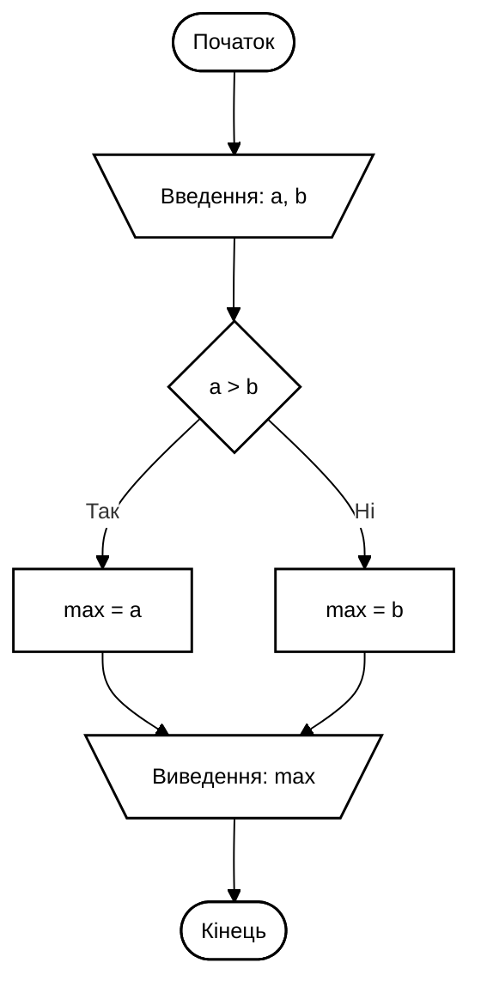
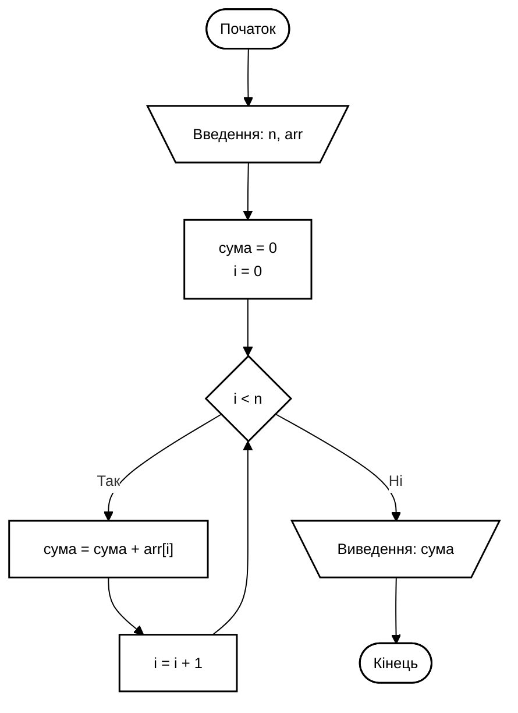

# Приклади схем V1: Академічний ГОСТ 19.701-90 та UML

Ця версія (V1) розроблена з урахуванням усіх ваших правок:
1. **Фон зображень:** прозорий (`transparent`) із білою заливкою всередині блоків (`#ffffff`), щоб лінії не перетинали текст.
2. **Жодних заголовків на самих зображеннях:** схема починається одразу з початкового вузла (`Початок` або початковий вузол UML), без зовнішніх рамок, заголовків та декоративних легенд.
3. **Мова тексту:** строго українська термінологія.
4. **Стиль:** суворий академічний ГОСТ 19.701-90 / ДСТУ ISO 5807 — чистий монохром, чорні лінії 1.5px, злами тільки під 90°.

> 🌐 **Перегляд у браузері:**
> Відкрийте [index.html](file:///C:/Users/muaro/Documents/GitHub/Learning-assistent/diagram_examples_v1/index.html) у браузері. Там є інтерактивний перемикач підкладки (білий фон, шахівниця для перевірки прозорості, темний фон).

---

## 📁 Файли прикладів V1

| Файл | Опис | Тип / Стандарт |
| :--- | :--- | :--- |
| [01_gost_branching.svg](file:///C:/Users/muaro/Documents/GitHub/Learning-assistent/diagram_examples_v1/01_gost_branching.svg) | Розгалужений алгоритм (пошук максимуму, if-else) | ГОСТ 19.701-90 |
| [02_gost_loop_while.svg](file:///C:/Users/muaro/Documents/GitHub/Learning-assistent/diagram_examples_v1/02_gost_loop_while.svg) | Цикл While з накопиченням суми та зворотною лінією зв'язку | ГОСТ 19.701-90 |
| [03_gost_loop_for.svg](file:///C:/Users/muaro/Documents/GitHub/Learning-assistent/diagram_examples_v1/03_gost_loop_for.svg) | Цикл For із шестикутником підготовки (модифікації) | ГОСТ 19.701-90 |
| [04_gost_subroutine.svg](file:///C:/Users/muaro/Documents/GitHub/Learning-assistent/diagram_examples_v1/04_gost_subroutine.svg) | Виклик підпрограми (зумовлений процес) та з'єднувач | ГОСТ 19.701-90 |
| [05_uml_activity_academic.svg](file:///C:/Users/muaro/Documents/GitHub/Learning-assistent/diagram_examples_v1/05_uml_activity_academic.svg) | UML Activity: паралелізм (Fork/Join), без заголовка | UML 2.5 |
| [06_uml_sequence_academic.svg](file:///C:/Users/muaro/Documents/GitHub/Learning-assistent/diagram_examples_v1/06_uml_sequence_academic.svg) | UML Sequence: запити, смуги активності, блок alt | UML 2.5 |
| [07_uml_class_academic.svg](file:///C:/Users/muaro/Documents/GitHub/Learning-assistent/diagram_examples_v1/07_uml_class_academic.svg) | UML Class: базовий клас, наслідування, інтерфейс | UML 2.5 |

---

## 💻 Код Mermaid (Чистий академічний стиль без заголовків)

### 1. ГОСТ Розгалуження (Mermaid):

### 2. ГОСТ Цикл While (Mermaid):

